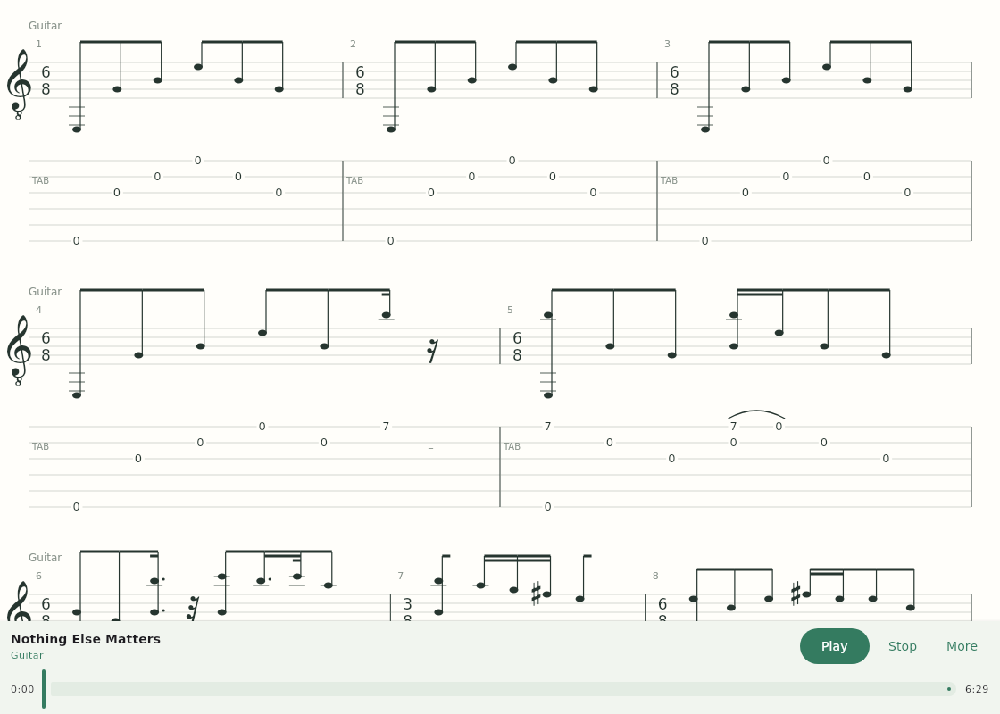

# Compose Tab

Version **0.2.0** · A UI-only Compose Multiplatform library for interactive guitar scores. Shared Kotlin code targets **Android, iOS and Desktop**. No player, audio engine, file parser or decoder dependency is included in the library.

## Modules

```text
score-model/   Plain Kotlin score values and validation; no Compose dependencies
score-ui/      Reactive state, pure layout geometry, Canvas rendering and hit testing
sample/        Independent consumer app, mock decoder, adapter and score studio screen
  src/commonMain/   Gp5Decoder → DecodedSong → ScoreData → ScoreComposable
  src/androidMain/ MainActivity + manifest
  src/desktopMain/ Desktop entry point
  src/iosMain/     MainViewController for a Swift host
```

The sample has a warm paper/green theme, notation/tab visibility controls, an animated zoom slider, drag/pinch navigation and an animated selection inspector. It intentionally has no playback controls. Night-paper styling and a pitch/string/fret inspector demonstrate host-driven customization.

## Run

Prerequisites: JDK 17+, Android SDK 35 (the included build config configures Android targets), network access to Gradle/Google/Maven repositories. iOS requires macOS and Xcode.

```sh
./gradlew :sample:run                      # Desktop
./gradlew :sample:assembleDebug            # Android APK
./gradlew :score-model:desktopTest :score-ui:desktopTest
./gradlew :sample:linkDebugFrameworkIosSimulatorArm64  # macOS
```

For iOS, embed the generated `ComposeTabSample.framework` in a Swift Xcode app and return `MainViewControllerKt.MainViewController()` from a `UIViewControllerRepresentable`. A SwiftUI host source is provided in `sample/iosApp/ScoreStudioApp.swift`; a generated Xcode project and signing configuration are not included. For local device builds, add a Run Script phase invoking `./gradlew :sample:embedAndSignAppleFrameworkForXcode` from the repository root, disable User Script Sandboxing, and follow Compose Multiplatform framework embedding conventions so bundled font resources are copied too. The Gradle sample is the separate application context; neither library module depends on it.

## GitHub build and real captures

`.github/workflows/build.yml` builds the Android APK and Desktop app, runs model/layout tests and real Compose pointer/keyboard tests under Xvfb, links an iOS simulator framework on macOS, and runs the Desktop application three times to capture real windows. APK, runnable Linux desktop distribution, framework, screenshots, and test reports are downloadable from each successful Actions run. Captures are also attached to this branch in `docs/screenshots/`. Images are produced by `java.awt.Robot`, not generated mockups. The packaged Linux binary is also launched in CI, with a screenshot smoke check; its tarball preserves executable permissions. Physical Android/iOS device testing is still a release requirement.

The sandbox has no JDK; build validation runs on GitHub-hosted runners. See the PR checks for the verified source revision.

## Public API

```kotlin
val state = rememberScoreState(scoreData)
ScoreComposable(
    state = state,
    modifier = Modifier.fillMaxSize(),
    style = ScoreStyle(
        accent = Color(0xFF347B60),
        measureWidth = 300f,
        showStaff = true,
        showTab = true,
        showTabRhythm = true,
    ),
    onEvent = { event ->
        when (event) {
            is ScoreEvent.NoteSelected -> inspectNote(event.noteId)
            ScoreEvent.SelectionCleared -> clearInspector()
            is ScoreEvent.ViewportChanged -> Unit
        }
    },
)
// Controlled by the host UI:
state.zoomTo(1.25f)
state.scrollTo(280f)
state.selectedNoteId = "my-stable-note-id"
```

`rememberScoreState` retains viewport and selection when data changes. Publish replacement data/lists rather than mutating lists in place. Stable IDs preserve selection across edits; clear selection yourself when deleting its note. State mutations should occur on the UI thread. `ScoreState` is not a player clock or decoder session. Pinch and drag update viewport events; direct state mutations are host commands and do not emit events.

## Data contract

`ScoreData → Track → Measure → Beat → Note`, with a sealed `Effect` vocabulary. This hierarchy follows the common score-oriented mental model used by applications such as [TuxGuitar](https://github.com/helge17/tuxguitar); **no TuxGuitar source was copied or linked**.

- Tuning is MIDI pitches in **string order 1..N** (high E first for standard guitar).
- Note string is one-based; fret is nonnegative; MIDI is 0..127.
- `staffStep` is diatonic distance above bottom treble E4 (0). Explicit accidentals avoid guessing enharmonic spelling in the renderer.
- Beats are a sequential, single-voice stream, with quarter-relative durations and optional dots. An empty note list represents a rest. Notes within one beat are simultaneous.
- IDs are globally unique; constructors reject duplicate IDs, invalid MIDI and invalid time signatures. Layout rejects strings outside the track's tuning.
- Lists are read-only by convention, not deeply immutable collections. Decoder-specific metadata stays in the adapter.

See `sample/.../DecoderAdapter.kt` for a deliberately small, suspendable decoder interface and explicit mapping. The mock does not parse GP5 bytes. A real decoder adapter should normalize timing and key spelling and report unsupported features rather than silently dropping them. If using TuxGuitar decoding code in a separate app, review its applicable license and platform/JVM dependencies first; it is not a portable commonMain dependency by default.

## Rendering architecture

1. **Model:** score values, with no drawing or platform concepts.
2. **Layout:** `layoutScore` computes aligned, adaptive measure columns, duration-weighted beat positions with minimum spacing, meter-aware beam segments, and independent staff/tab hit rectangles.
3. **Canvas:** uses cached geometry; converts logical dp to physical pixels once, applies viewport transforms, and skips off-screen measures before drawing.
4. **Interaction:** maps input back into score coordinates and emits stable-ID events. Staff note heads and fret numbers both select the same note while reporting which representation was clicked.

The baseline draws staff/tab lines, ledger lines, note heads, chord stems, meter-aware beams/rests, explicit accidentals, dots, repeat markers and illustrative bends/slides/hammer-ons/pull-offs/vibrato/palm mute. Zoom uses a spring; selection details use animated visibility. Dragging remains immediate, avoiding laggy gesture tracking. The host controls all surrounding UI and theme.

### Screenshots from the running Desktop app



[Tab-only view with rhythm](docs/screenshots/tab.png) · [Selected note inspector](docs/screenshots/selected.png)

These are captured automatically by GitHub Actions. The selected-note view uses deterministic sample state so screenshots are reproducible; separate Compose tests perform actual pointer and keyboard input.

### Customization

`ScoreStyle` controls colors, measure width, line spacing, track spacing, representation visibility, and optional tab-only rhythmic notation. Size the canvas via its modifier; no toolbar is forced on consumers. `onDrawEffect` is an additive `DrawScope` hook receiving the effect, anchor and style in logical score coordinates. Add a model effect, handle it in the renderer's exhaustive `when`, or decorate it in the hook. It is not a replacement hook for existing built-in marks.

### Performance and next steps

- Layout is memoized by data/style and is unaffected by selection or viewport changes.
- Canvas draws only visible measures in both axes; text layouts are cached with `rememberTextMeasurer`.
- Draw hit targets and notes from the same geometry to prevent independent drift.
- Visibility and hit lookup binary-search sorted measure bounds per visible track, then inspect only candidate measures. Keyboard navigation flattens targets on demand. Layout itself is whole-score and synchronous: compute incremental layouts off the UI thread for very large documents.
- Repeated lines are cheap vector primitives. For heavier static engraving, cache per-measure `ImageBitmap` tiles keyed by score revision, style, density and zoom bucket. Keep selection overlays live; evict tiles using an LRU memory budget. Bitmap caching is an optimization design, **not implemented here**, because it can blur during zoom and consume substantial memory.

## Scope / engraving limitations

This is an extensible working implementation scaffold, **not a complete production engraving engine**. In particular:

- One continuous horizontal system per track, no wrapping, pagination or print layout.
- Beam groups follow simple and compound meter with mixed-duration hooks. Asymmetric meter needs an explicit custom grouping policy. Stems point upward; no collision resolution for chord seconds/accidentals/effects yet.
- Treble clef only; no key-signature engraving, multi-voice timing, ties, tuplets, grace notes, alternate endings or cross-staff notation yet.
- Bundled OFL-licensed Bravura SMuFL glyphs render treble clefs, rests and accidentals. Noteheads, stems, beams and effects use vector geometry. Fret numbers use system text. See `THIRD_PARTY_NOTICES.md`.
- Effect marks are illustrative, not complete GP5 effect semantics. Track height expands for tuning string count; extreme ledger ranges may need host-adjusted track spacing.
- Touch/pointer drag and pinch, wheel/trackpad pan, Ctrl+wheel zoom, arrow-key note navigation, Escape to clear, and +/− zoom are implemented. Click the score to focus it. Canvas exposes score descriptions and next/previous/zoom accessibility actions; a full per-note semantic tree and screen-reader pitch announcements still need expansion before shipping an accessible editor.
- Zoom/selection are not saveable across process recreation; the host can persist its own state.

Before release: compile all targets, run the supplied model/layout tests, add screenshot/golden and pointer tests, test physical touch devices and build an accessibility overlay. No audio or file decoding should enter either library module during these extensions.

## Consuming library artifacts

The library modules use `maven-publish` with group `dev.composetab`, version `0.2.0`, including sources, KMP metadata and Android release variants. No Maven Central publication is claimed.

```sh
# Publish all supported targets on macOS with Android SDK + Xcode installed:
./gradlew :score-model:publishToMavenLocal :score-ui:publishToMavenLocal
# A desktop-only local build on Linux:
./gradlew :score-model:publishDesktopPublicationToMavenLocal :score-ui:publishDesktopPublicationToMavenLocal
```

For an app in this repository use `implementation(project(":score-ui"))`. A separately published KMP consumer uses `implementation("dev.composetab:score-ui:0.2.0")`; publish the root KMP and required platform publications together before using that coordinate. An optional `Build` Maven repository writes to each module's `build/repository` for staging. Production repository URL, signing, and credentials should be configured by the maintainer, never embedded in source.

## Try the packaged sample

From a successful [Actions run](https://github.com/romankolov/compose-tab/actions/workflows/build.yml), download `linux-desktop-app`, extract the artifact ZIP and then `ComposeTabStudio-linux-x64.tar.gz`, and run `ComposeTabStudio/bin/ComposeTabStudio`. It includes its own Java runtime; it needs a Linux graphical session and the normal system graphics libraries. Install the `android-debug` APK using `adb install -r sample-debug.apk` (debug-signed, not a store release). The `ios-simulator-framework` artifact is for an arm64 simulator host, not a standalone installable iOS application.

To package locally: `./gradlew :sample:createDistributable`. To recreate an individual screenshot: `./gradlew :sample:run --args="--screenshot=/absolute/path/capture.png --view=selected"` (views: `both`, `tab`, `selected`).

### Shipping a verified preview

`Ship verified preview` is a manual GitHub workflow. Supply a **successful build run ID from this branch** and a new preview tag. It verifies the run, downloads the already-tested artifacts (rather than rebuilding different binaries), and creates a prerelease attached to that exact source revision. It does not merge the PR, switch branches, upload to Maven Central, or publish to mobile stores.

If the GitHub App cannot dispatch workflows, the same verified-artifact shipping path can be triggered by an explicit `ship: verified preview …` commit updating `.github/preview-release.json` on the working branch. Ordinary pushes do **not** publish a release. The request must name a successful build from this branch and a new `vX.Y.Z-preview.N` tag; existing releases are not overwritten.
